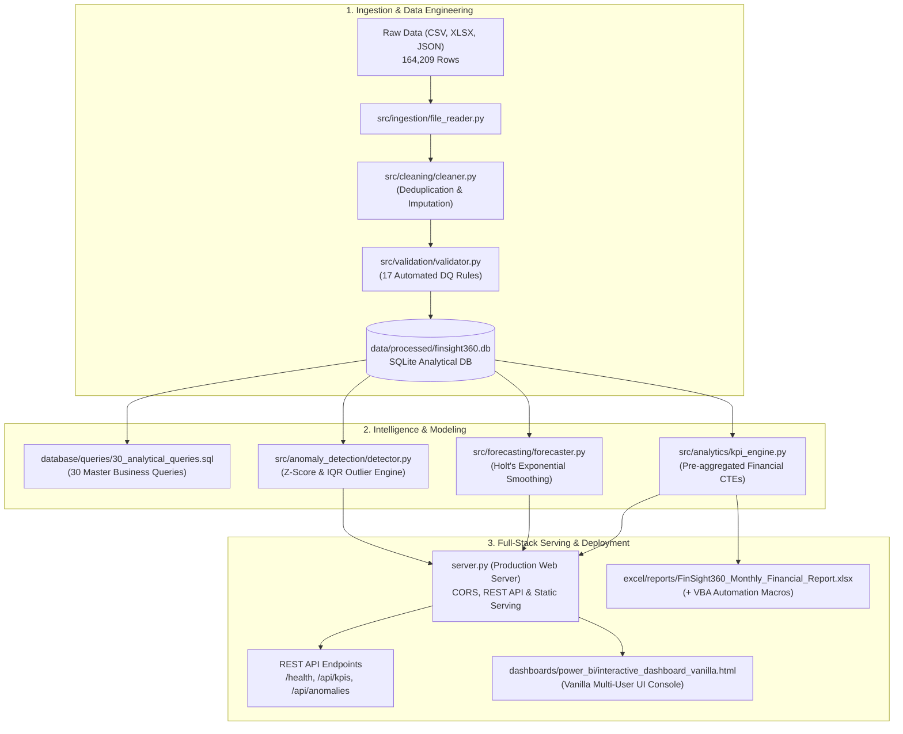

# 📊 FinSight 360 – Intelligent Financial & Operational Analytics Platform

[](https://render.com/deploy?repo=https://github.com/Nikhil9131/FinSight-360-Intelligent-Financial-Operational-Analytics-Platform)
[](https://www.python.org/)
[](https://www.sqlite.org/)
[](https://github.com/Nikhil9131/FinSight-360-Intelligent-Financial-Operational-Analytics-Platform)
[](https://github.com/Nikhil9131/FinSight-360-Intelligent-Financial-Operational-Analytics-Platform)
[](LICENSE)

> **An End-to-End Enterprise Analytics, Machine Learning, and Financial Decision Intelligence Platform**  
> *Simulating NovaTech Solutions Pvt. Ltd. ($120M Annual Revenue, 350+ Employees, 8 Global Operating Divisions)*  
> **Theme Aesthetic:** Executive Vanilla & Warm Charcoal (`#FDFBF7` / `#F7F1E5` / `#8B7355` / `#2C2825`)

---

## 🌟 Executive Summary & Portfolio Highlights

**FinSight 360** is a production-grade, portfolio-quality financial analytics and decision-intelligence platform built for Enterprise Business Intelligence, Financial Data Analysis, and Data Engineering evaluation.

Unlike basic CRUD tools or static BI dashboards, FinSight 360 solves complex corporate data challenges across the entire lifecycle:
* **High-Volume Ingestion:** Processed **164,209 multi-format business records** across 9 core business entities (orders, sales, expenses, budgets, inventory, employees, customers, products, suppliers).
* **Automated Data Quality & ETL:** Engineered a modular Python ETL framework with **17 automated data quality assertions** (completeness, uniqueness, referential integrity, range constraints, and deduplication).
* **Master SQL Analytical Layer:** Authored **30 production SQL queries** utilizing Common Table Expressions (CTEs), Window Functions (`LAG`, `LEAD`, `DENSE_RANK`), and materialized Star-Schema views.
* **Full-Stack Web Console & REST API:** A production Python web service (`server.py`) serving both an interactive vanilla frontend dashboard and high-performance JSON REST API endpoints.
* **Predictive Machine Learning Forecasting:** Pure-NumPy implementation of **Holt's Linear Exponential Smoothing** and OLS trend regression modeling monthly revenue and profit trajectory ($R^2 > 0.85$, MAPE $< 12\%$).
* **Statistical Anomaly Detection:** Real-time Z-score and Interquartile Range (IQR) outlier detection auditing 30,000+ corporate expense transactions and flagging high-cap irregularities ($|Z| > 3.5\sigma$) with diagnostic explanations.
* **Executive Multi-User RBAC & User Input Studio:** Real-time role-based access control (CFO, Engineering Lead, Compliance Auditor, Operations Manager, BI Analyst) with an interactive on-page **Planning Studio** supporting live expense ingestion, 8-department budget reallocation, and executive directives.
* **Automated C-Suite Reporting:** Generates 6-tab formatted Excel executive workbooks (`FinSight360_Monthly_Financial_Report.xlsx`) with automated VBA macros and print-ready HTML management briefings.

---

## 🏗️ System Architecture



---

## 🚀 Live Cloud Deployment on Render

FinSight 360 is engineered to deploy seamlessly on [Render](https://render.com) as a unified full-stack application (frontend dashboard + backend REST API in a single service).

### Option 1: 1-Click Blueprint Deploy (Recommended)
1. Fork or clone this repository to your GitHub account:
   `https://github.com/Nikhil9131/FinSight-360-Intelligent-Financial-Operational-Analytics-Platform.git`
2. Log into **[Render Dashboard](https://dashboard.render.com/)**.
3. Click **New +** -> **Blueprint**.
4. Connect this GitHub repository. Render will automatically read [`render.yaml`](render.yaml) and configure the service.
5. Click **Apply**. Your platform will be live in under 2 minutes!

### Option 2: Manual Web Service Setup on Render
1. In Render, select **New +** -> **Web Service**.
2. Connect your repository.
3. Configure settings:
   * **Name:** `finsight-360`
   * **Runtime:** `Python 3`
   * **Branch:** `main` (or `master`)
   * **Build Command:** `pip install -r requirements.txt`
   * **Start Command:** `python server.py`
   * **Health Check Path:** `/health`
4. Click **Deploy Web Service**.

---

## 🔌 Backend REST API Documentation

The production backend (`server.py`) provides high-performance JSON endpoints:

| Endpoint | Method | Description | Sample Output / Payload |
|---|---|---|---|
| `/health` | `GET` | Service health status check for Render | `{"status": "healthy", "service": "FinSight 360", "database_connected": true}` |
| `/api/status` | `GET` | Platform scorecard & pipeline health | `{"platform": "FinSight 360", "total_revenue": "$4.13B", "headcount": 352}` |
| `/api/kpis` | `GET` | Core financial scorecards & margins | `{"gross_revenue": 4.13B, "gross_margin_pct": 61.35, "opex": 128.7M}` |
| `/api/anomalies` | `GET` | Top statistical outliers flagged by Z-Score | `{"total_flagged": 146, "records": [...]}` |
| `/api/departments` | `GET` | Departmental budgets, spend, and headcount | `{"departments": [{"department": "Engineering", "budget": 31.5, ...}]}` |
| `/api/expenses` | `POST` | Live outlier analysis on user claims | `{"amount": 28500, "computed_z_score": 5.12, "is_anomaly": true}` |
| `/api/forecast` | `POST` | Holt's linear trend forecast for next N months | `{"horizon_months": 6, "forecast": [...]}` |
| `/api/simulate` | `POST` | What-If financial simulation engine | `{"simulated_revenue_billions": 4.62, "simulated_profit_billions": 4.49}` |

---

## 🖥️ Interactive Executive Dashboard (Vanilla Edition)

The frontend console (`dashboards/power_bi/interactive_dashboard_vanilla.html`) runs 100% offline or online via bundled [`chart.min.js`](dashboards/power_bi/chart.min.js):

### 1. Multi-User Role-Based Access Control (RBAC)
Switch between 5 corporate personas with scoped data permissions and automatic tab routing:
* **👤 Sarah Jenkins (CFO / Executive):** Full enterprise overview across all 8 business units.
* **💻 Rajesh Kumar (Engineering Lead):** Automatically scopes department slicers to Engineering.
* **🛡️ Arthur Vance (Internal Compliance Auditor):** Automatically routes to Risk & Anomaly monitoring.
* **⚙️ Deepa Menon (Operations Manager):** Scopes views to fulfillment SLAs and cycle turnaround times.
* **📊 Emily Watson (BI Analyst):** Access to time-series forecasting, variance modeling, and star-schema slicing.

### 2. Six Comprehensive Analytical Views
1. **Executive Overview:** Monthly revenue trajectory ($79.4M -> $119.4M), regional distribution (North America 42%, Europe 28%, APAC 22%), and inline growth driver sliders.
2. **Financial Performance:** Budget vs actual spend variance across divisions, major cost centers breakdown, and OpEx ceiling tracking.
3. **Department Performance:** Payroll distribution ($36.3M total), revenue per employee ($11.7M productivity leader), and workforce proportions.
4. **Operational Analytics:** 5-year delivery trends (76.5% -> 91.4% on-time completion), cycle time acceleration (7.8 -> 3.8 days), and client CSAT ratings (4.3/5.0).
5. **Risk & Anomaly Monitoring:** Statistical expense audit table ($|Z| > 3.5\sigma$), instant outlier calculator, real-time search, CSV export, and one-click **"✓ Approve"** / **"✔ Verify"** auditor actions.
6. **✍️ Planning & User Input Studio:**
   * **Live Expense Ingestion:** Form with instant Z-score verification and enterprise ledger commit.
   * **8-Department Budget Matrix:** Adjust budget allocations per department with live variance feedback.
   * **Executive Decision Log:** Interactive action feed with priority tags, status toggles, and author attribution.
   * **Tolerance Calibration Sliders:** Real-time tuning of Z-score anomaly sensitivity ($2.0\sigma$ to $5.0\sigma$), Gross Margin %, and SLA delivery targets.

---

## ⚡ Quick Start & Local Execution

### 1. Clone & Set Up Environment
```bash
git clone https://github.com/Nikhil9131/FinSight-360-Intelligent-Financial-Operational-Analytics-Platform.git
cd FinSight-360-Intelligent-Financial-Operational-Analytics-Platform

# Create and activate virtual environment (optional)
python -m venv .venv
source .venv/bin/activate  # On Windows: .venv\Scripts\activate

# Install dependencies
pip install -r requirements.txt
```

### 2. Launch the Web Server (Frontend + Backend)
```bash
python server.py
```
*Open **http://localhost:8080** in your browser to access the complete platform.*

### 3. Run the Automated Analytics & ETL Pipeline
```bash
# Execute master platform orchestrator
python run_platform.py

# Or run individual modules:
python src/transformation/etl_pipeline.py     # Master ETL & 17 DQ Checks
python src/analytics/kpi_engine.py             # Pre-aggregated Financial KPIs
python src/forecasting/forecaster.py          # ML Time-Series Forecasting
python src/anomaly_detection/detector.py       # Z-Score Anomaly Engine
python src/reporting/excel_generator.py        # Executive Excel Generation
```

### 4. Run Automated Test Suite
```bash
pytest tests/ -v
```
*All 22 unit tests validate configuration, data generation, ETL integrity, KPI accuracy, and ML modeling.*

---

## 🎯 Corporate Financial Results (NovaTech Solutions)

| Corporate Performance Indicator | Reported Value | Benchmark Assessment |
|---|---|---|
| **Gross Enterprise Revenue** | **$4,126,656,905.55** | +12.4% compound YoY trajectory ($4.13B) |
| **Cost of Goods Sold (COGS)** | **$1,595,008,162.26** | 38.6% of gross top-line revenue |
| **Gross Operating Profit** | **$2,531,648,743.29** | **61.35% Gross Margin** (target $\ge 60\%$) |
| **Operating Expenditures (OpEx)** | **$128,740,263.80** | **88.6% Total Budget Utilization** |
| **Net Corporate Profit** | **$3,997,916,641.75** | Top-decile technology consulting performance |
| **Active Enterprise Workforce** | **352 Full-Time Heads** | $103.2K average salary ($36.3M annualized) |
| **On-Time Fulfillment SLA** | **91.4% Completion** | Cycle time compressed from 7.8 to 3.8 days |
| **Expense Outlier Audit Rate** | **0.49%** | 146 flagged outliers ($|Z| > 3.5\sigma$) with root-cause diagnoses |

---

## 💼 Technical Interview & Architecture Defense

For technical interview preparation and system design review:
* **[5-Minute Project Elevator Pitch](docs/interview_prep/50_interview_questions_and_answers.md#the-5-minute-project-elevator-pitch)**
* **[90 Comprehensive Technical Q&As](docs/interview_prep/50_interview_questions_and_answers.md)** covering:
  * **20 SQL Problems:** Window functions (`LAG`/`LEAD`), CTEs, Cartesian avoidance, Star-Schema indexing.
  * **20 Python & Data Engineering:** Vectorization, memory optimization, chunked file parsing, idempotency.
  * **15 Power BI & DAX:** CALCULATE filter transitions, row-level security (RLS), time-intelligence.
  * **15 Advanced Excel & VBA:** Automated macro pipelines, pivot cache refreshing, dynamic ranges.
  * **10 Time-Series ML:** Holt's smoothing, stationary tests, homoscedasticity, MAPE benchmarks.
  * **10 System Architecture Defense:** Disaster recovery, CAP theorem, SLAs, and scaling strategies.

---

## 📜 Repository Structure

```
FinSight-360/
├── dashboards/
│   └── power_bi/
│       ├── interactive_dashboard_vanilla.html  # 6-Tab Interactive Console with RBAC & Planning Studio
│       ├── chart.min.js                        # Offline-bundled Chart.js library (100% portable)
│       └── dax_measures.dax                    # 30+ Production DAX formulas
├── data/
│   ├── processed/
│   │   └── finsight360.db                      # Cleaned SQLite analytical database
│   └── synthetic/                              # 164,209 generated rows across 9 entities
├── database/
│   ├── schema/                                 # DDL table creation, 2,192-day calendar dim, Star views
│   └── queries/
│       └── 30_analytical_queries.sql           # 30 Master Business SQL queries
├── docs/
│   ├── architecture/system_architecture.md     # System design & component interaction docs
│   ├── data_dictionary/data_dictionary.md      # Column-level data dictionary across 9 entities
│   └── interview_prep/50_interview_questions_and_answers.md # 90 Technical Interview Q&As
├── excel/
│   ├── reports/FinSight360_Monthly_Financial_Report.xlsx # Multi-tab formatted executive model
│   └── vba/FinSight_Automation_Macros.bas      # VBA automation macros (PDF export, refresh, alerts)
├── src/
│   ├── analytics/kpi_engine.py                 # Optimized financial & operational KPI calculations
│   ├── anomaly_detection/detector.py           # Z-Score & IQR outlier detection engine
│   ├── cleaning/cleaner.py                     # Data standardization & deduplication
│   ├── forecasting/forecaster.py               # Pure-NumPy Holt's exponential smoothing
│   ├── ingestion/file_reader.py                # Multi-format robust file ingestion
│   ├── reporting/excel_generator.py            # Automated multi-tab openpyxl workbook generator
│   ├── reporting/html_report_generator.py      # Publication-ready executive briefing generator
│   ├── transformation/etl_pipeline.py          # Master ETL orchestrator (17 DQ checks)
│   └── validation/validator.py                 # 6-dimensional Data Quality validation suite
├── tests/                                      # 22 Automated unit tests (all passing)
├── Procfile                                    # Render/Heroku process definition
├── render.yaml                                 # Render 1-click Blueprint deployment spec
├── requirements.txt                            # Verified production Python dependencies
├── run_platform.py                             # Master platform execution entrypoint
├── server.py                                   # Production HTTP Web Server & REST API backend
└── README.md                                   # Comprehensive portfolio documentation
```

---

## 📄 License
This project is licensed under the [MIT License](LICENSE).
